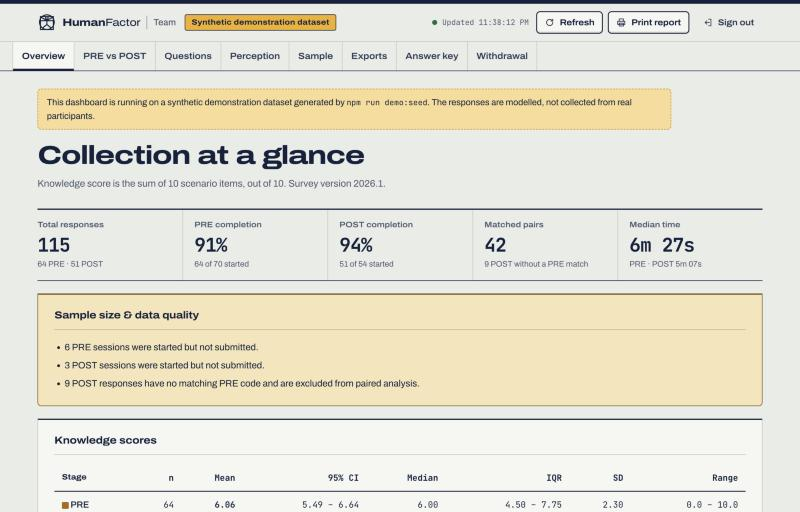
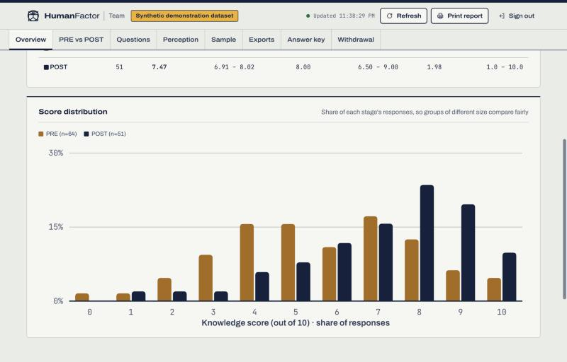
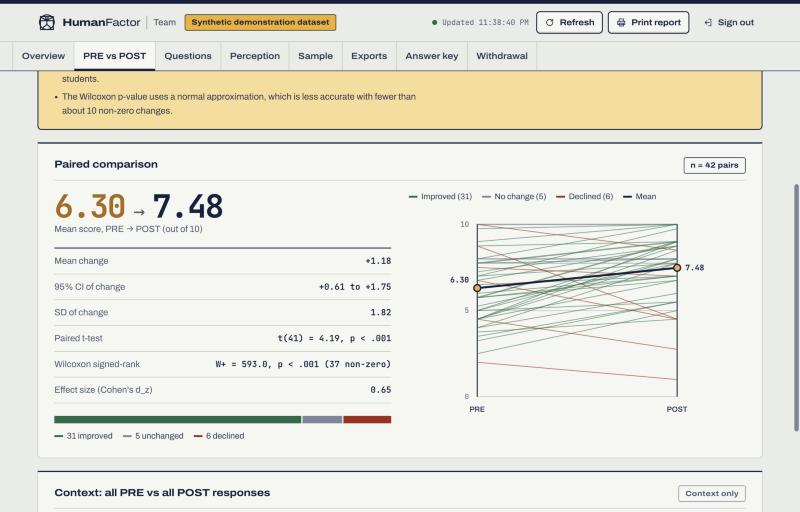
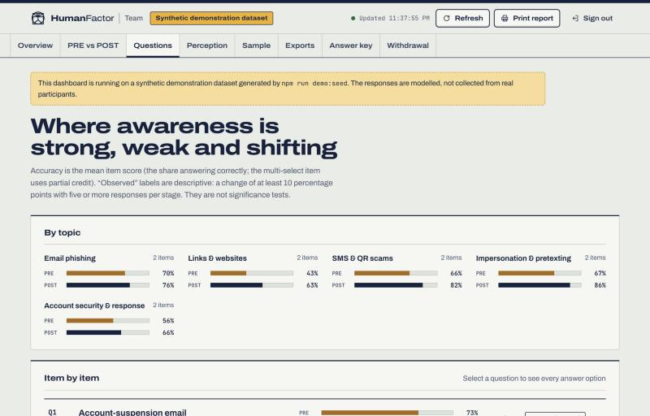
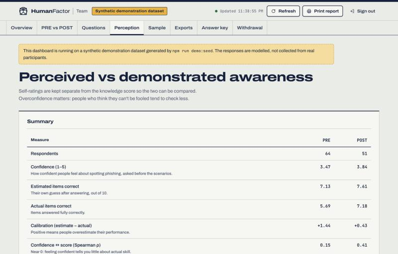
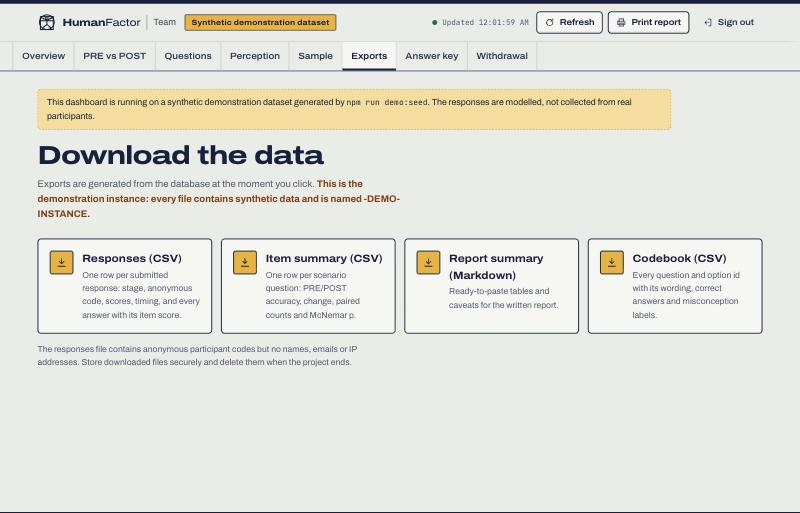

# HumanFactor — analytics demonstration report

**Human-Centred Security Awareness (HLAC) · HumanFactor project team · 29 October 2026**

HumanFactor is our platform for measuring whether a phishing and social-engineering awareness
campaign changes how students recognise scams. This report walks through the study design and
the analysis the platform produces, so that we can get approval to deploy it with real
participants.

> **About the figures.** HumanFactor has not been deployed yet. The results below come from a
> modelled demonstration dataset of 115 responses, built to exercise every part of the analysis
> before any participant takes part. They show what our final report will contain. They are not
> study findings.

---

## 1. Study design

| | |
|---|---|
| **Topic** | Phishing and social engineering: the attacks students actually meet (account-suspension emails, parcel-fee texts, "send me the code" messages, QR stickers) |
| **Design** | PRE survey before the campaign, POST survey after it. Both use the same 10 scenario questions, with option order shuffled per participant |
| **Measures** | **Demonstrated knowledge** (10 scored scenarios, 0–10). **Perceived awareness** (confidence 1–5, asked before the scenarios; self-estimated score, asked after). Optional demographics. Campaign exposure (POST) |
| **Scoring** | 1 point per scenario. The multi-select item uses partial credit (correct picks − incorrect picks, ÷ 4, floored at 0). "I'm not sure" scores 0 but is recorded separately from wrong answers, so uncertainty and misconceptions can be told apart |
| **Matching** | A random anonymous code is issued at PRE and re-entered at POST. No names, emails, student IDs or IP addresses are collected |
| **Length** | 15 questions at PRE (about 7 minutes), 13 at POST (about 6 minutes) |

Each wrong answer is mapped to a named misconception, for example "believes the padlock means a
site is safe", so the results show *what* people get wrong, not just how many get it wrong. The
full question rationale is in [SURVEY_DESIGN.md](SURVEY_DESIGN.md).

---

## 2. Sample and completion

| | PRE | POST |
|---|---|---|
| Sessions started | 70 | 54 |
| Responses submitted | 64 | 51 |
| Completion rate | 91% | 94% |
| Median time to complete | 6 min 27 s | 5 min 07 s |

**42 participants** completed both surveys with matching codes. They form the paired sample.
Nine POST responses had no matching PRE code. They count in the overall results but are excluded
from the paired comparison.

---

## 3. Knowledge scores

| | n | Mean | 95% CI | Median | SD | Range |
|---|---|---|---|---|---|---|
| PRE | 64 | 6.06 | 5.49 – 6.64 | 6.00 | 2.30 | 0 – 10 |
| POST | 51 | 7.47 | 6.91 – 8.02 | 8.00 | 1.98 | 1 – 10 |

### Paired comparison (primary analysis)

Among the 42 matched participants, the mean score rose from **6.30 to 7.48 out of 10**:

- **Mean change:** +1.18 (95% CI +0.61 to +1.75)
- **Paired t-test:** t(41) = 4.19, p < .001
- **Wilcoxon signed-rank:** p < .001 (a check that doesn't assume normality)
- **Effect size:** Cohen's d_z = 0.65 (moderate)
- **Individuals:** 31 improved, 5 unchanged, 6 declined

The dashboard presents this as **observed change, not proof of cause**. With no control group,
seeing the same questions twice, discussion between participants, and self-selection could all
contribute. The final report will say so.

---

## 4. Where awareness is strong, weak and shifting

| # | Scenario | Topic | PRE | POST | Change |
|---|---|---|---|---|---|
| 1 | Account-suspension email | Email phishing | 73% | 75% | +1 pp (unchanged) |
| 2 | Reading a URL | Links & websites | 42% | 59% | +17 pp |
| 3 | What the padlock means | Links & websites | 44% | 67% | +23 pp |
| 4 | Phishing warning signs | Email phishing | 67% | 78% | +11 pp |
| 5 | Parcel-fee text message | SMS & QR scams | 70% | 86% | +16 pp |
| 6 | Unexpected sign-in approvals | Account security | 47% | 59% | +12 pp |
| 7 | Friend asks for a code | Impersonation | 63% | 82% | +20 pp |
| 8 | Lecturer gift-card request | Impersonation | 72% | 90% | +18 pp |
| 9 | QR code on a parking meter | SMS & QR scams | 63% | 78% | +16 pp |
| 10 | After entering a password | Account security | 66% | 73% | +7 pp (unchanged) |

By topic, the largest gains are in **links and websites** (43% → 63%) and **impersonation**
(67% → 86%). The weakest areas at baseline are reading a URL and understanding what the padlock
means. Both get dedicated campaign content.

The "improved / unchanged" labels are descriptive (a change of at least 10 percentage points).
Item-level McNemar tests are reported as exploratory because they aren't corrected for multiple
comparisons.

### Most common misconceptions (PRE)

1. **31%:** believe the padlock means a website is safe (Q3).
2. **25%:** don't realise that unexpected sign-in prompts mean the password is already known
   (Q6).
3. **23%:** treat irrelevant details, such as send time or logos, as warning signs (Q4).
4. **17%:** read the brand at the start of a web address as the real domain (Q2).

These feed directly into campaign content and recommendations.

---

## 5. Perceived vs demonstrated awareness

| | PRE | POST |
|---|---|---|
| Confidence (1–5) | 3.47 | 3.84 |
| Estimated items correct | 7.13 | 7.61 |
| Actual items correct | 5.69 | 7.18 |
| **Calibration** (estimate − actual) | **+1.44** | **+0.43** |
| Confidence ↔ score correlation (Spearman ρ) | 0.15 | 0.41 |

At baseline, participants overestimate their performance by about 1.4 questions, and confidence
barely predicts actual skill. Keeping self-ratings separate from the knowledge score lets the
report show this gap and whether it narrows.

---

## 6. Sample description and campaign exposure

- **Field of study** (optional, 58 answered): computing 18, business 14, arts/humanities 14,
  other STEM 6, health 4.
- **Prior security training:** 19 yes, 33 no, 10 unsure or prefer not to say.
- **Campaign exposure (POST):** social media posts 32, posters 22, videos 18, quiz or poll 9,
  live session 6, none 8.
- Participants who saw at least one campaign element (n = 38) scored a mean of 7.67 at POST,
  against 6.69 for those who saw none (n = 8). Exposure is self-reported and not randomised, so
  this is context, not evidence of effect.

---

## 7. How the numbers are checked

- **Independent verification:** `npm run demo:verify` recomputes 184 statistics straight from
  the raw database tables and compares them with the dashboard. All 184 match. The checks cover
  counts, completion, means, medians, histogram bins, every item's accuracy and option counts,
  paired change, and integrity (each score equals the sum of its item scores).
- **Automated tests:** 63 tests pass, covering scoring, the statistics (checked against R
  reference values), anonymous code matching, and the full API with a real database.
- **Exports:** response-level CSV, item summary CSV, a codebook, and a ready-to-paste Markdown
  summary for the report.

---

## 8. Ethics and data protection

- **Informed consent** is required before any question is shown. Participants confirm they are
  18 or over.
- **Anonymous by design:**
  - no names, emails, student IDs or IP addresses are collected;
  - three optional, coarse demographic questions, each with "prefer not to say";
  - a random code links each person's PRE and POST responses.
- **Voluntary:** participants can stop at any time and nothing is sent until they submit.
  They can withdraw afterwards by emailing their code, and the team deletes everything under it.
- **Restricted access:** responses are visible only to the team, through a password-protected
  dashboard, and results are reported only as group statistics.
- **No feedback:** participants never see correct answers or their score, so the PRE survey
  doesn't itself act as an intervention.

---

## 9. Deployment plan, and what we're asking

1. Approval of the consent text, eligibility (18+), data retention period and withdrawal
   procedure.
2. Final study details added: institution, team contact email, campaign channels.
3. Deployment to HTTPS hosting with persistent storage, followed by a short pilot with 3–5
   students.
4. PRE survey, campaign, then POST survey, with daily data backups.

---

*The screenshots in this report are captures of the HumanFactor team dashboard running the
demonstration dataset.*
