# HumanFactor — redesign and pre-deployment audit

**Date:** 28 October 2026 · **Scope:** the full application (participant survey, team dashboard,
API, database, demo data, documentation) · **Build audited:** local, Node 22.22.1, Vite 8 production
build.

All screenshots in this report are **genuine captures** of the running application taken on 28 Oct
2026 in the in-app Chromium browser. Desktop frames are 800px-wide downsamples of a 1280px
viewport; mobile frames are 375px wide at 2× density. Dashboard screenshots show the **synthetic
demonstration dataset** (see §4), which is labelled as such in the interface.

---

## 1. Summary

| Area | Result |
|---|---|
| Automated tests | **63 / 63 passing** (5 files) |
| Typecheck (`tsc --noEmit`) | Clean |
| Production build | Succeeds. The dashboard is code-split, so participants never download it |
| Dependency audit (`npm audit --omit=dev`) | 0 known vulnerabilities |
| Analytics vs. raw data | **184 / 184** independent checks match, on both the demo DB and the live DB |
| End-to-end flows | PRE, POST, validation, resume, consent gate, code matching, completion, dashboard, exports and demo labelling were exercised in the browser |
| Responsive / themes | Checked at 375px (no horizontal scroll), 800px, 1280px and 1440px, in light and dark mode |
| Independent review | Verdict "fix" (1 high, 4 medium); all material findings fixed and re-verified (§5) |
| Verdict | **Ready for the professor demonstration** on the demo instance. **Not yet ready for real participants.** See the blockers in §7 |

## 2. What changed

### Redesign

The generic, AI-default look (cream ground, italic serif display, a label above every heading,
soft cards) is replaced by a committed **1970s public-information print** world: ink navy and
safety marigold on grey form stock, the Archivo width axis for a wide poster voice, ruled boxes,
halftone exhibit boards, a ruler progress bar, ticket-stub participant codes and a rubber-stamp
completion mark. The full system is documented in [DESIGN.md](../DESIGN.md).

How the three requested skills were applied:

- **Impeccable.** It was installed, and its new-work and craft-floor references were read and
  applied:
  - Removed: the banned labels above headings, decorative monospace, the coloured left border
    (> 1px) on the demo banner, and gradient and glass effects.
  - Added: themed browser surfaces (selection, focus, scrollbars, caret), one authored motion
    moment, and contrast checks.
  - Its launcher binary (which downloads and runs code) was deliberately **not** run, so its
    automated detector and concept-roll steps were not available. The finish review was done by an
    independent sub-agent instead (§5).
- **UI UX Pro Max.** It was installed, but its Python search script was blocked by the
  environment's safety policy, so its CSV catalogue and pre-delivery checklist were read directly.
  The catalogue rates neon retro styles (retro-futurism, vaporwave, Y2K) as poor for education and
  accessibility, which is why the direction is print retro rather than screen retro.
- **Taste.** This is the installed ecc "taste" skill. It is a creative-direction layer for *music
  videos*, so only its general principle was transferable: commit to one named genre family
  ("Retro / print") and execute it coherently.

### Branding

- Renamed to **HumanFactor** across page titles, metadata, the favicon, navigation, the dashboard,
  the survey title, the stamp, server logs, export filenames (`humanfactor-*`) and all
  documentation.
- New **Vitruvian mark**, drawn to Leonardo's construction: the circle is centred on the navel and
  the square sits on the base. It comes in two weights, a legible mark for 26–44px and a
  construction drawing for plates.
- The **icon set** was redrawn as one family: 24-unit grid, 1.75 stroke, square caps, mitred
  joins. Emoji and Unicode arrows used as icons were removed.
- Internal identifiers were kept so nothing breaks: the cookie name, the localStorage keys and the
  `data/hlac.db` default path.

### Functionality preserved

No survey logic, scoring, authentication, database schema or statistics were changed by the
redesign. The behaviour changes are the fixes listed in §3, plus the new demo instance in §4.

## 3. Findings and fixes (this audit)

| # | Severity | Finding | Fix | Status |
|---|---|---|---|---|
| F1 | **High** | A dev server left running from an earlier session held API port 3000 against the **real** database. A new dev server could not bind the port, and its web proxy silently sent traffic to the old server. As a result, an audit test submission landed in `data/hlac.db`. | Removed that row (13 answers, 1 response, 1 session; no orphans). Added `scripts/check-port.mjs` to `predev` and `prestart`, so startup now refuses when the API port is taken, and the server exits loudly on `EADDRINUSE`. Tested in both states. | Fixed |
| F2 | Medium | `demo:reset` deleted the database file. A demo server that was already running kept serving the deleted copy, showing stale data. | Reset now empties the tables in place, in one transaction. Verified on a running server, which then served the fresh dataset. | Fixed |
| F3 | Medium | The Exports tab said "Demonstration data is excluded" on the demo instance, where *all* data is synthetic. That was misleading. | The copy now states that the demo instance is entirely synthetic and that files are named `-DEMO-INSTANCE`. | Fixed |
| F4 | Medium | Selected-answer styling depended on the CSS `:has()` selector, so older browsers (Firefox < 121, Safari < 15.4) would not show which answer is chosen. | Added an explicit `is-checked` class fallback on options, scale boxes and the consent row. | Fixed |
| F5 | Low | The footer lost its side gutter (a padding shorthand overrode the shell padding); text touched the left edge. | Changed to `padding-block`. | Fixed |
| F6 | Low | The rubber-stamp text overran its ring; the completion heading repeated "Recorded" three times. | Re-sized the arc text; the heading is now "Thank you." | Fixed |
| F7 | Low | The survey intro wasted the right half of desktop screens, and the masthead didn't line up with the content. | The intro uses the poster layout with the Vitruvian plate, and the masthead width follows the content. | Fixed |
| F8 | Low | The full Vitruvian figure (two leg poses) turned into a blob at header size. | A small-size mark variant with one leg pose; the full drawing is kept for plates. | Fixed |

The findings from the independent finish review are in §5.

## 4. Synthetic demonstration data

**Design decision.** The synthetic responses are *structurally* indistinguishable from real ones:

- they use the same tables and the same `createSession` / `validateAndScore` / `insertResponse`
  code path as the API;
- `is_demo = 0`;
- timestamps are realistic and backdated.

But they live in a **separate database file** (`data/demo.db`), and the dashboard shows a
persistent *Synthetic demonstration dataset* marker. Synthetic data presented without a label could
be mistaken for collected data, and that would undermine the ethics approval this demo is meant to
win. The label is the honest way to show the real analytics working.

**Model.** The data comes from a 2-parameter IRT model:

- person ability θ ~ N(0, 1);
- demographics and prior training that shift θ;
- per-item difficulty and discrimination, plus distractor-specific misconception weights;
- "not sure" rates that rise as ability falls;
- confidence weakly correlated with ability, plus overconfidence;
- campaign exposure that shifts POST ability, with larger gains on targeted items;
- a testing effect;
- abandonment (about 9% of PRE sessions);
- lost codes, POST-only newcomers, and a diurnal timing pattern.

The PRNG is seeded (seed 2026), so the dataset is reproducible.

| Statistic (seed 2026) | Value |
|---|---|
| PRE / POST responses | 64 / 51 (70 / 54 sessions started) |
| Matched pairs | 42 (9 POST unmatched) |
| Mean knowledge score | PRE 6.06 → POST 7.47 |
| Paired change | +1.18 (95% CI 0.61 – 1.75), t(41) = 4.19, p = .0001, d_z = 0.65 |
| Improved / unchanged / declined | 31 / 5 / 6 |
| Calibration (overconfidence) | +1.44 PRE → +0.43 POST |

**Commands:** `npm run demo:reset` (re)creates the dataset; `npm run demo` serves it;
`npm run demo:verify` checks it. Both `demo:seed` and `demo:reset` **refuse** to write to the live
database path; this is covered by a test.

**Verification.** `npm run demo:verify` recomputes from raw SQL, without the dashboard's own
helpers, and compares against the dashboard's analytics:

- per-stage counts, sessions, means, medians and histogram bins;
- every item's accuracy and every option count per stage;
- matched pairs and paired change;
- improved / declined counts;
- confidence and exposure distributions;
- integrity checks: each knowledge score equals the sum of its item scores, and each
  `fully_correct` count equals the number of items scored 1.

**Result: 184/184 match** on `data/demo.db` and on `data/hlac.db`. The dashboard figures shown in
the screenshots (115 responses, 42 pairs, +1.18, CI 0.61–1.75, t(41) = 4.19) agree with the
verifier's output.

## 5. Independent finish review

A fresh reviewer sub-agent reviewed the screenshots and source against Impeccable's craft floor
and UI UX Pro Max's pre-delivery checklist, and measured contrast itself. It had no access to
the build conversation. Its verdict was **"fix"**, driven by one accessibility bug. Every material
finding was addressed:

| # | Severity | Reviewer finding | Fix | Verified |
|---|---|---|---|---|
| R1 | **High** | No keyboard focus ring on any button: `.btn`'s own `box-shadow` overrode the global `:focus-visible` ring (WCAG 2.4.7). | `.btn:focus-visible` restores the ring. The global rule uses a transparent outline, so forced-colours mode still shows focus. | Tabbed to "Get started" with real key presses: `:focus-visible` matches and the full ink + marigold ring renders (screenshot 18). |
| R2 | Medium | A radio that is both focused and checked lost its ring, which is the normal state when using arrow keys. | Combined `checked:focus-visible` rule. | CSS rule present; same mechanism as R1. |
| R3 | Medium | Dashboard tab and item focus rings in light mode were marigold on paper, 1.77:1. | The ring is now ink (14.8:1). | Code change. |
| R4 | Medium | Sign out was icon-only on mobile, with no accessible name. | `aria-label="Sign out"`. | Code change. |
| R5 | Medium | The review step hid which answers were missing; the disclosure had no affordance, and the progress bar said "All questions answered". | The list opens automatically when anything is unanswered. Added a chevron. Unanswered required items show in red, skipped ones as "Skipped". The progress bar now reads "Review: 12 of 15 answered". | Captured (screenshot 09) and checked through the accessibility attribute. |
| R6 | Low | The stamp text still collided at the arc join. | `textLength` with `lengthAdjust="spacing"` fits it to the ring. | Captured (screenshot 09b). |
| R7 | Low | `--faint` measured 3.94:1, below AA. | `#5f6880` (about 4.6:1). | Token change. |
| R8 | Low | Upcoming ruler ticks were 1.4:1 and nearly invisible. | They now use the control-border colour. | Captured (screenshot 09). |
| R9 | Low | `.btn--sm` was 36px, under the 44px touch target. | 44px minimum on touch-sized screens. | Captured (the "Change" buttons in screenshot 09). |
| R10 | Low | Mobile dashboard tabs gave no hint that they scroll. | An edge fade on the tab strip. | Code change. |

Considered and left as they are:

- "~7 min" (PRE intro) and "6–7 min" (landing) are both true. PRE is about 7 minutes and POST
  about 6.
- The export cards stay as they are. They are a functional list, and the reviewer rated them
  acceptable.

Reviewer's measured contrast (after the fixes, light / dark):

| Pair | Ratios | Result |
|---|---|---|
| Body text | 13.4 / 15.6 | pass |
| Muted text | 5.8 / 8.0 | pass |
| Faint text (after R7) | ~4.6 / 5.9 | pass |
| Navy on marigold | 8.4 / 9.6 | pass |
| Control borders | 3.45 / 3.76 | pass |
| PRE ochre series (non-text) | 4.1 / 7.4 | pass |
| POST ink series | 14.8 / 14.2 | pass |

The reviewer's design risks (an OS-only dark mode on lab projectors, greyscale printing of the
charts, a font-load fallback, 200% zoom on 320px screens, and the paired plot at hundreds of pairs)
are carried into §8.

## 6. Test results

```
tests/api.test.ts             26 passed   real Express + SQLite: no answer-key leakage, security headers, persistence,
                                          idempotency, validation (422), malformed/oversized bodies, SQL-looking input,
                                          PRE/POST matching, duplicate blocking, admin auth (missing/forged/expired
                                          tokens, logout, disabled admin, rate limit), analytics from stored data,
                                          demo exclusion, CSV columns, exports, withdrawal, restart persistence,
                                          static serving, demo-instance labelling
tests/scoring.test.ts         17 passed   answer-key integrity, single/partial/"not sure" scoring, required/optional,
                                          stage-specific questions, invalid input
tests/stats.test.ts           10 passed   t, Welch, paired t, Wilcoxon, McNemar, CI, Cohen's d, Spearman vs R values
tests/demo.test.ts             6 passed   generator realism, determinism, verifier agreement, live-DB guard
tests/participantCode.test.ts  4 passed   format, normalisation, every single-character typo detected
Test Files  5 passed (5)      Tests  63 passed (63)
```

Manual end-to-end checks in the browser:

- **Consent:** the start button stays disabled until the box is ticked.
- **Validation:** a required question shows an inline error.
- **Keyboard:** number keys and Enter work.
- **Answers:** multi-select exclusivity works, and option order is shuffled per session.
- **Participant code:** it is issued and displayed, Copy and Save work, and the completion screen
  shows it again.
- **Submission:** it persists to SQLite (checked by query), and the review count is correct.
- **Dashboard:** login works; every tab renders with the demo marker, and its numbers agree with
  the verifier. Exports carry the `-DEMO-INSTANCE` names.
- **Layout and themes:** no horizontal scroll at 375px, and dark mode was checked.

The previous audit's checks (network failure keeps answers, resume after reload, POST code
matching, production build under the strict CSP with no console errors) still hold; the flows they
cover were not changed.

## 7. Blockers before real-world deployment

These must be done before real participants use the site:

1. **Ethics approval.** Get written approval from the professor (and any departmental ethics
   process) for the consent text, the 18+ eligibility assertion, the data retention period and the
   withdrawal procedure.
2. **Fill in the study details** in `web/src/studyInfo.ts`. The institution is still "your
   university" and the contact email is the placeholder `hlac-team@example.edu`. Participants
   currently have no real withdrawal contact.
3. **Match the campaign-exposure options** (`r_exposure` in `server/survey/definition.ts`) to the
   channels actually used, *before* PRE launches. Changing questions after collection starts
   breaks comparability.
4. **Wipe the live database.** `data/hlac.db` holds one real-looking test response (`Y53Z10ZQ`,
   from an earlier manual click-through). Stop the server, delete `data/hlac.db*` and run
   `npm run db:init`, or delete the row via the dashboard's Withdrawal tab.
5. **Deploy to HTTPS hosting with a persistent disk.** Set `NODE_ENV=production`, a strong
   `ADMIN_PASSWORD`, a random `SESSION_SECRET`, `TRUST_PROXY=true`, and `DATABASE_PATH` on the
   disk. The server refuses weak or missing secrets in production. Never deploy with
   `DEMO_INSTANCE=true` or with `demo.db` as the database.
6. **Pilot with 3–5 students** from the target audience. Check that the wording is understood, the
   time is about 7 minutes, and nothing confuses people on their own phones (Safari on iOS and
   Chrome on Android were not tested on real devices).
7. **Set up backups.** Download `humanfactor-responses-*.csv` daily during collection, or schedule
   a SQLite `.backup`.

## 8. Remaining risks (accepted or to monitor)

- **Causality.** There is no control group, the same items are used at PRE and POST (testing
  effect), and the sample is self-selected. The dashboard and the summary export state this; the
  report must too.
- **Anonymous matching** depends on participants keeping their code. A code is a bearer token:
  anyone who learns it could pre-empt that participant's POST. The team can remove a bad
  submission via Withdrawal.
- **Duplicate prevention without identity is best-effort.** Someone could take PRE twice in
  different browsers.
- **Single shared admin password** and stateless 8-hour sessions, with no per-user accounts or
  audit log. Rotate `SESSION_SECRET` to revoke all sessions.
- **Rate limits** are in memory and per IP (1,000 per 15 minutes on the survey endpoints, 10
  failed logins per 15 minutes).
- **Accessibility** was checked structurally: semantic controls, labels, focus rings, contrast
  tokens and reduced motion. It was **not** tested with a real screen reader (VoiceOver or
  NVDA).
- **Browser coverage.** The browser checks ran in Chromium only. Firefox and Safari rely on the
  `:has()` fallback added in F4.
- **SQLite on a single server** suits a class-sized study, not horizontal scaling.
- **Display conditions** (from the finish review):
  - Dark mode follows the operating system only, so a lab projector could show "night print".
  - Charts printed in greyscale may merge PRE and POST, but the direct labels remain.
  - If the self-hosted Archivo fails to load, headings fall back to a normal-width system font.
  - 200% zoom on a 320px screen is untested.
  - The paired slope chart will saturate at several hundred pairs.
- **The skills' tooling was only partly used.** Impeccable's detector binary and UI UX Pro Max's
  search script were not executed (one by choice, one blocked), so their automated checks did not
  run. Their written guidance was applied manually.

## 9. Screenshots

| | |
|---|---|
| 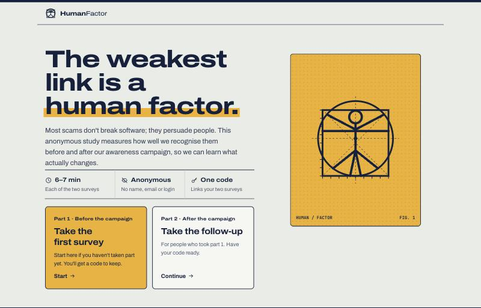 Landing page (desktop) | 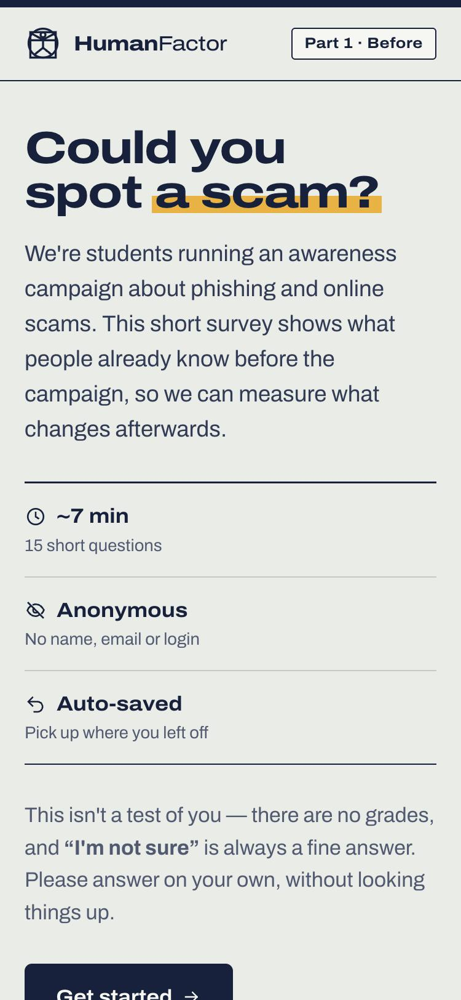 PRE intro (mobile) |
| 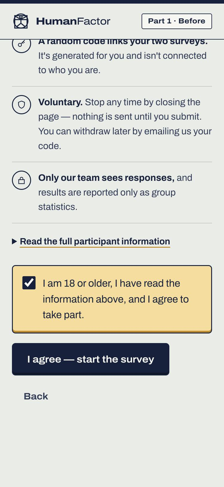 Consent, ticked (mobile) | 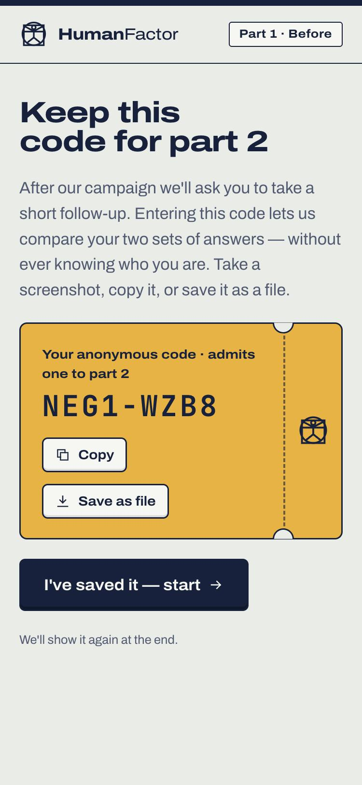 Anonymous code ticket |
| 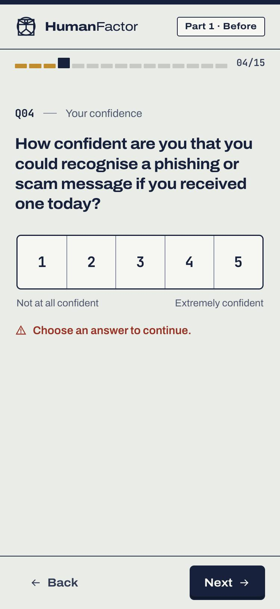 Required-answer validation | 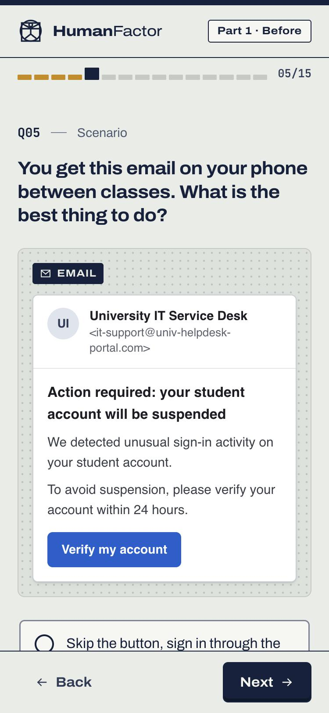 Email scenario exhibit |
| 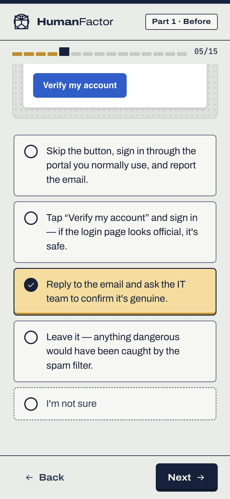 Selected ballot option | 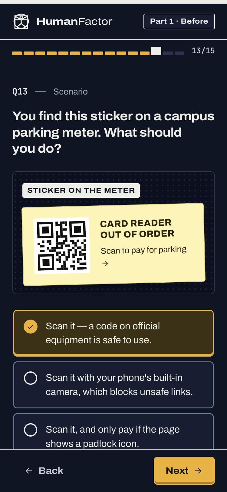 QR scenario, dark mode |
| 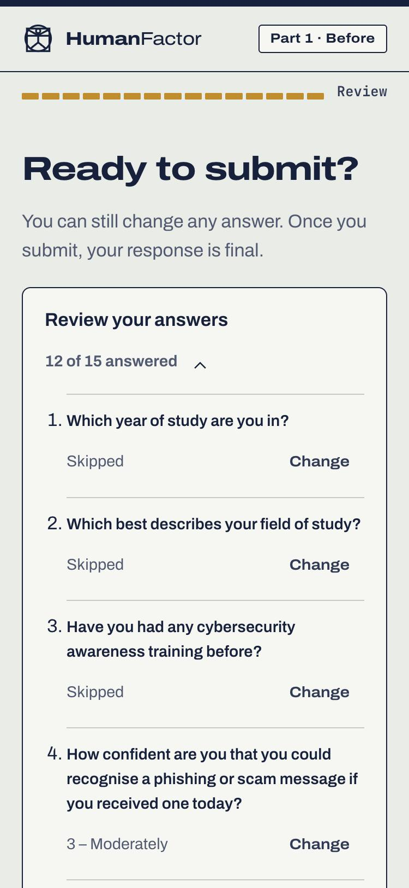 Review before submit | 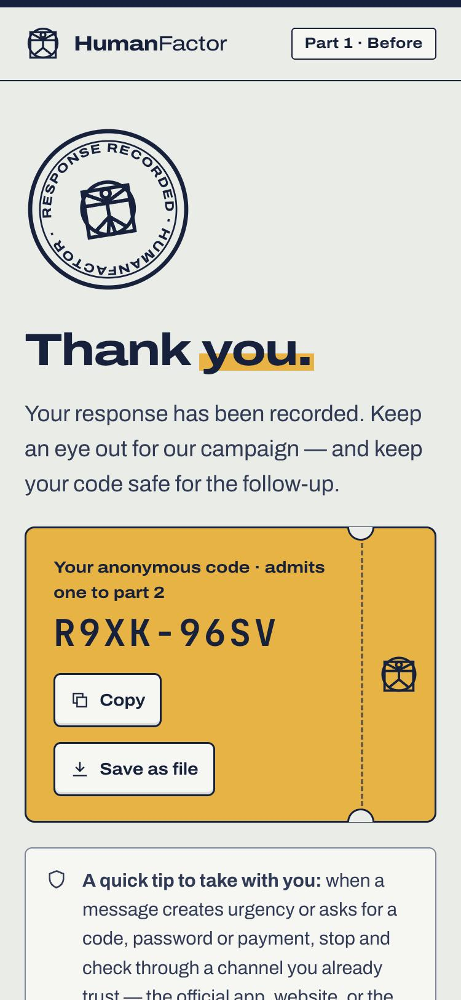 Completion stamp and code |
|  Dashboard overview (synthetic dataset) |  Score distribution, PRE vs POST |
|  Topic and item accuracy |  Paired comparison and slope chart |
|  Perceived vs demonstrated awareness |  Exports |
| 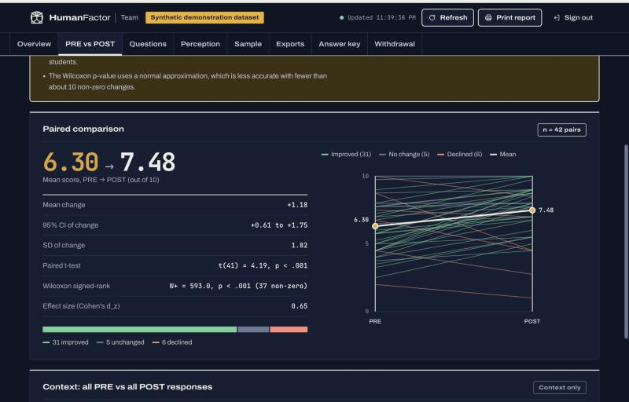 Paired comparison, dark mode | 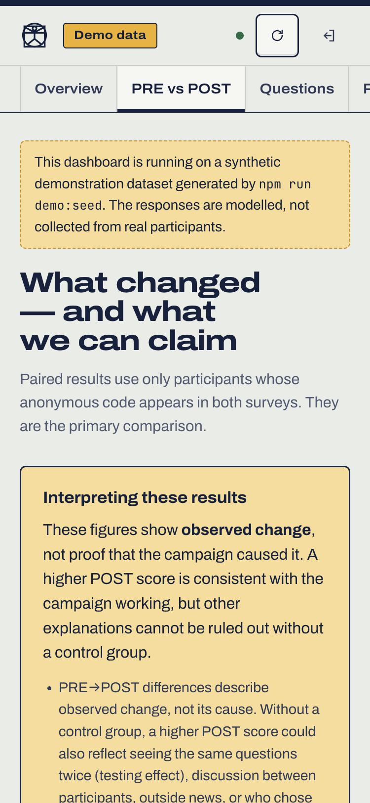 Dashboard at 375px |
| 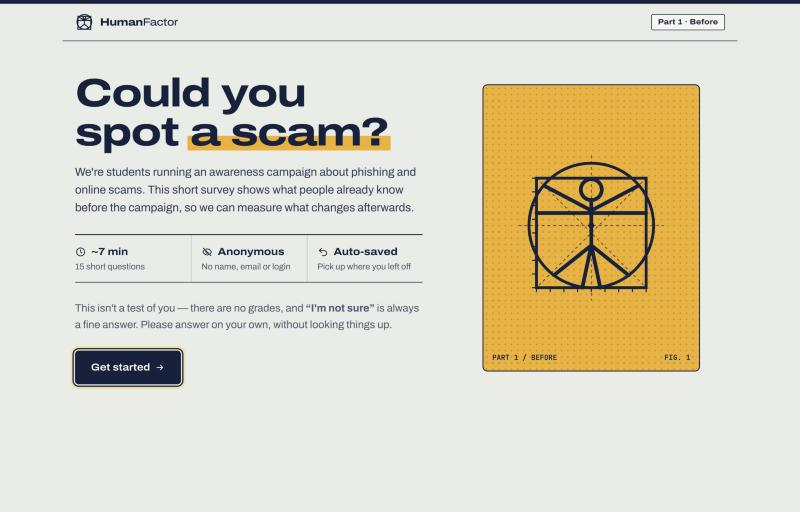 Survey intro with keyboard focus on "Get started" (after fix R1) | |
